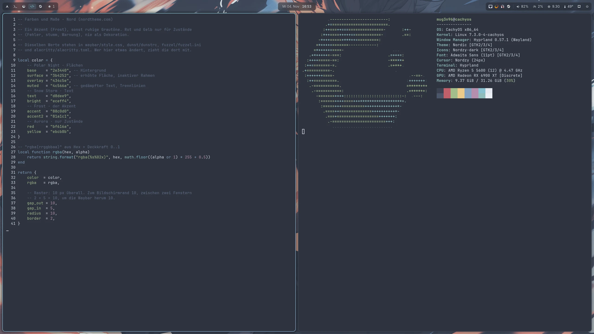
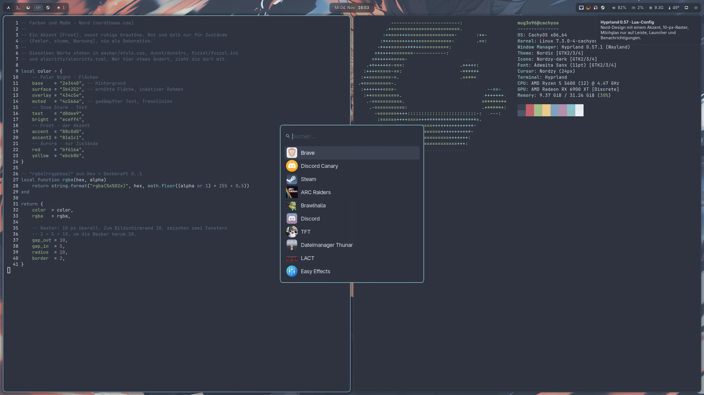
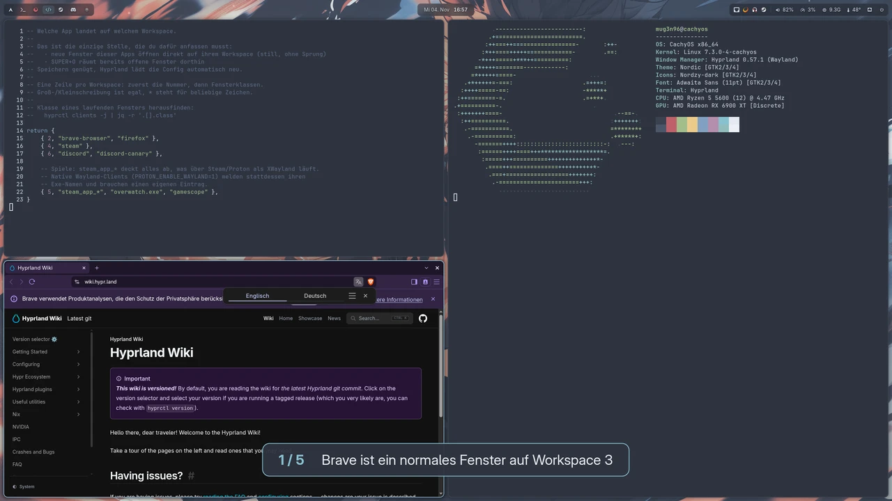

# dotfiles · CachyOS-PC

**Hyprland 0.57 mit Lua-Config · Nord-Design · ein Akzent, ein Raster**

> **English:** Personal dotfiles for a CachyOS desktop running **Hyprland ≥ 0.55 with the new Lua config**
> (`hyprland.lua`; hyprlang/`hyprland.conf` was removed in 0.57). Comments and docs are in German, but the
> config may be a useful reference if you are migrating: modular Lua setup, generated window rules, a Lua-based
> "sort windows" bind, ported `hyprctl` scripts (`keyword` → `eval`), a Waybar scratchpad button and a local
> wallpaper animator. Hardware-specific bits (monitor `DP-3`, AMD GPU, Sunshine) need adapting.




---

## Inhalt

- [Was drin ist](#was-drin-ist)
- [Tastenkürzel](#tastenkürzel)
- [Maus: Leiste, Benachrichtigungen, Fenster](#maus)
- [Funktionen im Alltag](#funktionen-im-alltag)
- [Design-System](#design-system)
- [Gaming](#gaming)
- [Installation](#installation)
- [An einen anderen Rechner anpassen](#an-einen-anderen-rechner-anpassen)
- [Hyprland mit Lua: Hinweise für Umsteiger](#hyprland-mit-lua-hinweise-für-umsteiger)
- [Fehlersuche](#fehlersuche)
- [Dotfiles verwalten](#dotfiles-verwalten)

---

## Was drin ist

| Pfad | Zweck |
|---|---|
| `.config/hypr/hyprland.lua` | Einstieg, lädt nur die Module |
| `.config/hypr/lua/theme.lua` | Farben und Maße, die eine Quelle für alles Optische |
| `.config/hypr/lua/system.lua` | Monitor, Umgebungsvariablen, Eingabe, Autostart |
| `.config/hypr/lua/look.lua` | Abstände, Rahmen, Schatten, Blur, Animationen |
| `.config/hypr/lua/rules.lua` | Fenster-, Layer- und Workspace-Regeln, Workspace-Zuordnung, SUPER+O |
| `.config/hypr/lua/binds.lua` | Tastenkürzel |
| `.config/hypr/workspaces.lua` | **Welche App auf welchem Workspace landet** – die Datei zum Anfassen |
| `.config/hypr/scripts/` | `hdr-toggle`, `screenshot`, `powermenu`, `clipboard`, `wallpaper`, `waybar-scratchpad` |
| `.config/waybar/` | Leiste: drei Inseln, Scratchpad-Knopf |
| `.config/dunst/dunstrc` | Benachrichtigungen |
| `.config/fuzzel/fuzzel.ini` | Launcher (auch für Power-Menü und Zwischenablage) |
| `.config/alacritty/alacritty.toml` | Terminal |
| `.config/gtk-3.0`, `.config/gtk-4.0`, `.config/Kvantum` | GTK-/Qt-Theme (Nordic, Nordzy) |
| `.config/swappy/config` | Screenshot-Editor |
| `.config/sunshine/`, `.local/bin/sunshine-display` | Game-Streaming per Sunshine/Moonlight |
| `.local/bin/ocr-shot` | Text aus einem Bildschirmbereich erkennen |
| `Bilder/wallpaper-animiert/render.py` | Baut aus dem Wallpaper eine animierte Schleife |
| `.config/fish/functions/dotfiles.fish` | Befehl `dotfiles` für dieses Repo |

Nicht im Repo: das Wallpaper-Bild selbst (Fan-Art) und die gerenderten Videos.

---

## Tastenkürzel

`Super` ist die Windows-Taste. Das Muster zieht sich durch: **Super + Taste** tut etwas,
**+ Shift** nimmt das Fenster mit, **+ Ctrl** verschiebt es still (ohne mitzugehen).

### System

| Kürzel | Aktion |
|---|---|
| `Super + Enter` | Terminal (Alacritty) |
| `Super + D` | Launcher (Fuzzel) |
| `Super + V` | Zwischenablage-Verlauf |
| `Super + Shift + Q` | Fenster schließen |
| `Super + Shift + E` | Power-Menü: Abmelden, Neustart, Herunterfahren |
| `Super + Shift + C` | Config neu laden |
| `Super + Shift + B` | Renderer neu laden (bei Grafikfehlern) |
| `Super + Shift + D` | Benachrichtigungsdienst neu starten |
| `Ctrl + Shift + Esc` | Mission Center (Taskmanager) |

### Fenster

| Kürzel | Aktion |
|---|---|
| `Super + H J K L` oder `Super + Pfeile` | Fokus nach links / unten / oben / rechts |
| `Super + Shift + H J K L` / `+ Pfeile` | Fenster in die Richtung verschieben |
| `Super + Q` | Teilung umschalten (nebeneinander ↔ übereinander) |
| `Super + Space` | Vollbild an/aus |
| `Super + Shift + Space` | Schwebend an/aus |
| `Super + A` | Zum zuletzt benutzten Fenster |
| `Super + R`, dann `H J K L` / Pfeile | Größe ändern (halten wiederholt), `Enter`/`Esc` beendet. Die Leiste zeigt den Modus an. |
| `Super + O` | Alle Fenster auf ihren Stamm-Workspace räumen (siehe `workspaces.lua`) |

### Workspaces

| Kürzel | Aktion |
|---|---|
| `Super + 1 … 8` | Zu Workspace 1–8 |
| `Super + Shift + 1 … 8` | Fenster dorthin verschieben und mitgehen |
| `Super + Ctrl + 1 … 8` | Fenster dorthin verschieben, hierbleiben |
| `Alt + Shift + 1 … 8` | wie `Super + Shift` (alte Variante) |
| `Super + Tab` | Zum vorherigen Workspace |
| `Super + Shift + Tab` | Fenster zum vorherigen Workspace, mitgehen |
| `Super + Ctrl + Tab` | Fenster zum vorherigen Workspace, hierbleiben |

### Scratchpad

Eine Ebene, die über jedem Workspace eingeblendet werden kann – für Fenster, die man immer
schnell braucht (Terminal, Chat, Notizen). Erscheint als Karte mit abgedunkeltem Desktop dahinter.
Bebilderte Demo: [Funktionen im Alltag → Scratchpad](#scratchpad-1).

| Kürzel | Aktion |
|---|---|
| `Super + -` (Minus) | Scratchpad ein-/ausblenden |
| `Super + Shift + -` | Fenster ins Scratchpad, mitgehen |
| `Super + Ctrl + -` | Fenster ins Scratchpad, hierbleiben |
| `Super + Mausrad` | Scratchpad ein-/ausblenden |

### Apps und Werkzeuge

| Kürzel | Aktion |
|---|---|
| `Super + F1` | VS Code |
| `Super + F2` | Brave |
| `Super + F3` / `Super + Shift + F3` | Dateimanager (PCManFM) / als Root |
| `Super + F4` | HDR an/aus |
| `Super + F5` | Musik im Terminal (mocp) |
| `Super + F12` | Audio neu starten (PipeWire, WirePlumber) |
| `Super + Ctrl + M` | Mixer (alsamixer) |
| `Super + E` | Eigenes Brave-Fenster (Klasse `TFTExcel`) |
| `Super + Shift + W` | Wallpaper: animiert ↔ Standbild |

### Screenshots und Text

| Kürzel | Aktion |
|---|---|
| `Print` | Ganzer Bildschirm |
| `Super + Shift + S` | Bereich auswählen |
| `Super + Shift + T` | Text aus einem Bereich erkennen (Deutsch + Englisch) → Zwischenablage. Nochmal drücken bricht ab. |

Screenshots landen in `~/Bilder/Screenshots` (bzw. dem XDG-Bilderordner) **und** in der Zwischenablage.
Die Benachrichtigung zeigt eine Vorschau mit dem Knopf **Bearbeiten** (öffnet Swappy).

### Medientasten

Funktionen auch bei gesperrtem Bildschirm. Lautstärke in 3-%-Schritten, maximal 100 %.

| Taste | Aktion |
|---|---|
| Lauter / Leiser / Stumm | Ausgabe (wpctl) |
| Mikrofon stumm | Eingabe |
| Play/Pause, Weiter, Zurück | Aktueller Player (playerctl, z. B. Spotify) |

---

## Maus

### In der Leiste

| Wo | Aktion |
|---|---|
| Arch-Logo links | Launcher öffnen |
| Workspace-Symbol | Zum Workspace wechseln |
| Ebenen-Symbol (Scratchpad) | **Klick:** ein-/ausblenden · **Rechtsklick:** aktives Fenster hineinlegen. Die Zahl zeigt, wie viele Fenster darin liegen. |
| Uhr | Darüberfahren zeigt den Kalender mit Kalenderwochen |
| Lautstärke | **Klick:** Pavucontrol · **Rechtsklick:** stumm · **Mausrad:** lauter/leiser |
| RAM, Temperatur, Netzwerk | Darüberfahren zeigt Details (z. B. IP-Adresse) |
| Power-Symbol rechts | Power-Menü |

### Benachrichtigungen

| Klick | Aktion |
|---|---|
| Links | Aktion ausführen (falls vorhanden) und schließen |
| Mitte | Alle schließen |
| Rechts | Diese schließen |

### Fenster

| Kürzel | Aktion |
|---|---|
| `Super + Linksklick ziehen` | Fenster verschieben |
| `Super + Rechtsklick ziehen` | Größe ändern |
| `Super + Mittelklick` | Schwebend an/aus |

---

## Funktionen im Alltag

### Apps automatisch auf ihren Workspace

`~/.config/hypr/workspaces.lua` legt fest, welche App wo öffnet:

```lua
return {
    { 2, "brave-browser", "firefox" },
    { 4, "steam" },
    { 6, "discord", "discord-canary" },
    { 5, "steam_app_*", "overwatch.exe", "gamescope" },   -- Spiele
}
```

Groß-/Kleinschreibung ist egal, `*` steht für beliebige Zeichen. Neue Fenster öffnen **still** auf
ihrem Workspace (kein Sprung). **Speichern genügt**, Hyprland lädt die Config selbst neu.
`Super + O` räumt danach auch die schon offenen Fenster an ihren Platz. Klasse eines Fensters herausfinden:

```sh
hyprctl clients -j | jq -r '.[].class'
```

### Scratchpad

Typischer Ablauf: Terminal oder Chat mit `Super + Shift + -` (oder Rechtsklick auf das Ebenen-Symbol)
ins Scratchpad legen, dann mit `Super + -` jederzeit über dem aktuellen Workspace einblenden und wieder
weg. Ein leeres Scratchpad lässt sich nicht öffnen – der Knopf sagt dann, wie man es füllt.



Der Knopf in der Leiste (Ebenen-Symbol, markiert) zeigt den Zustand: **gedimmt** = leer,
**mit Zahl** = so viele Fenster liegen darin, **im Akzent hinterlegt** = gerade eingeblendet.

### Zwischenablage-Verlauf

Alles, was kopiert wird, sammelt `cliphist`. `Super + V` öffnet die Liste im Launcher, Tippen filtert,
`Enter` legt den Eintrag wieder in die Zwischenablage.

### HDR

Der Desktop läuft bewusst in **SDR**: auf einem DisplayHDR-400-Monitor wirken normale Inhalte im HDR-Modus
flau. `Super + F4` schaltet HDR (10 bit, PQ/BT.2020) für Filme und Spiele zu. Spiele vorher umschalten,
dann starten, damit sie den HDR-Schalter anbieten. Jeder Config-Reload stellt wieder SDR her.

```sh
~/.config/hypr/scripts/hdr-toggle [on|off|toggle|status]
```

### Animiertes Wallpaper

`render.py` baut aus `~/Bilder/wallpaper.png` lokal (ohne KI-Dienst) eine nahtlose 10-Sekunden-Schleife:
Hitzeflimmern auf den Flammen, aufsteigende Glut, pulsierendes Glühen. Gesicht und Figur liegen in einer
Schutzzone und bleiben pixelgenau still. Abgespielt wird per `mpvpaper`, das **automatisch pausiert,
sobald ein Fenster im Vollbild ist** – im Spiel kostet es nichts.

```sh
~/.config/hypr/scripts/wallpaper toggle          # animiert ↔ Standbild (auch Super + Shift + W)
~/.config/hypr/scripts/wallpaper fps 55          # Bildrate wählen (55 oder 165)
python3 ~/Bilder/wallpaper-animiert/render.py --preview    # Standbilder + Schleifentest
python3 ~/Bilder/wallpaper-animiert/render.py --fps 55     # Video rendern (~2–3 min)
```

55 fps sind ein Drittel von 165 Hz: jedes Bild steht exakt drei Refreshes lang – gleichmäßig ohne Judder.
30 fps auf 165 Hz würde abwechselnd 5 und 6 Refreshes ergeben. Die Schutzzonen in `render.py` sind auf
dieses eine Motiv zugeschnitten; für ein anderes Bild müssen sie angepasst werden.

### Game-Streaming (Sunshine/Moonlight)

Beim Verbinden schaltet `sunshine-display start` den Monitor auf 2560×1440 @ 90 Hz, beim Trennen zurück
auf 165 Hz. Der HDR-Zustand bleibt dabei erhalten. Eingebunden über `global_prep_cmd` in `sunshine.conf`.

---

## Design-System

**Ein Raster, eine Rundung, ein Akzent.** Alles Optische hängt an `lua/theme.lua`; dieselben Werte stehen
in Waybar, Dunst, Fuzzel und Alacritty.

| Rolle | Farbe | Verwendung |
|---|---|---|
| Fläche | `#2e3440` | Hintergründe (Nord Polar Night) |
| Erhöht | `#3b4252` | Auswahl, inaktiver Rahmen |
| Gedämpft | `#4c566a` | Nebensächliches |
| Text | `#d8dee9` | Schrift (Nord Snow Storm) |
| **Akzent** | `#88c0d0` → `#81a1c1` | aktiver Rahmen, aktiver Workspace, Launcher-Rahmen – sonst nirgends |
| Fehler | `#bf616a` | nur Zustände: stumm, getrennt, zu heiß |
| Warnung | `#ebcb8b` | nur Zustände: hohe Last |

| Maß | Wert |
|---|---|
| Abstand | 10 px überall: zum Bildschirmrand, zwischen Fenstern (2 × 5), um die Leiste |
| Rundung | 10 px außen, 6 px innen (Knöpfe in der Leiste, Auswahl im Launcher) |
| Rahmen | 2 px, aktiv als Verlauf im Akzent |
| Schrift | Adwaita Sans (Oberfläche), JetBrains Mono Nerd Font (Terminal, Icons) |
| Themes | Nordic (GTK), Nordic (Kvantum/Qt), Nordzy-dark (Icons), Nordzy-cursors |

**Effekte:** Animationen 100–150 ms ohne Nachfedern. Milchglas (Blur) nur hinter Leiste, Launcher und
Benachrichtigungen, nie hinter Fenstern. Die Leiste ist zu 35 % getönt, der Blur selbst leicht abgedunkelt,
damit Text auch über hellen Stellen im Wallpaper lesbar bleibt. Das aktive Fenster wirft einen kräftigeren
Schatten als die anderen.

---

## Gaming

- **Overwatch 2** bekommt Tearing (`immediate`) für minimale Latenz. Mit `PROTON_ENABLE_WAYLAND=1` heißt das
  Fenster `overwatch.exe`, nicht `steam_app_…` – die Regel deckt beides ab. Wirkungslos, wenn
  `MESA_VK_WSI_PRESENT_MODE=mailbox` in den Startoptionen steht.
- **VRR** nur im Vollbild (`misc.vrr = 2`), **Direct Scanout** an.
- Animationen, Blur und das animierte Wallpaper kosten im Vollbild nichts: Direct Scanout umgeht den
  Compositor, mpvpaper pausiert.
- Spiele landen automatisch auf Workspace 5.

---

## Installation

Das Repo ist ein **Bare-Repo**: die Dateien liegen an ihrem normalen Ort im Home, Git verwaltet sie aus
`~/.dotfiles` heraus. Nichts wird verlinkt oder verschoben.

### 1. Pakete

```sh
# Offizielle Repos (unter CachyOS sind awww und mpvpaper dabei, auf reinem Arch evtl. AUR)
sudo pacman -S --needed hyprland xdg-desktop-portal-hyprland hyprpolkitagent \
    dunst fuzzel alacritty awww mpvpaper \
    grim slurp swappy wl-clipboard cliphist jq socat libnotify xdg-user-dirs \
    wireplumber playerctl pavucontrol network-manager-applet kvantum \
    adwaita-fonts ttf-jetbrains-mono-nerd ttf-nerd-fonts-symbols \
    tesseract tesseract-data-deu tesseract-data-eng imagemagick

# AUR: Themes und Waybar-Git
paru -S nordic-theme-git kvantum-theme-nordic-git nordzy-icon-theme nordzy-cursors waybar-git

# Nur für render.py
sudo pacman -S --needed python-numpy python-pillow python-scipy ffmpeg
```

**Warum `waybar-git`?** Waybar 0.15.0 schickt bei Klicks auf Workspaces noch die alte Befehlssyntax, die
Hyprland mit Lua-Config nicht mehr versteht. Ab Waybar 0.16 reicht das normale Paket.

### 2. Dotfiles holen

```sh
git clone --bare https://github.com/Mug3n96/dotfiles-cachyos-pc.git ~/.dotfiles
alias dotfiles='git --git-dir=$HOME/.dotfiles --work-tree=$HOME'
dotfiles config status.showUntrackedFiles no

# Vorhandene Dateien, die überschrieben würden, nach ~/.dotfiles-backup sichern
dotfiles ls-tree -r --name-only HEAD | while read -r f; do
    [ -e "$HOME/$f" ] && mkdir -p "$HOME/.dotfiles-backup/$(dirname "$f")" && mv "$HOME/$f" "$HOME/.dotfiles-backup/$f"
done
dotfiles checkout
```

Unter fish ist `dotfiles` danach dauerhaft da (`.config/fish/functions/dotfiles.fish`), unter bash die
`alias`-Zeile in die `~/.bashrc` eintragen.

### 3. Einrichten

```sh
systemctl --user enable --now hyprpolkitagent.service    # Passwortdialoge für Admin-Aktionen
gsettings set org.gnome.desktop.interface gtk-theme 'Nordic'
gsettings set org.gnome.desktop.interface icon-theme 'Nordzy-dark'
gsettings set org.gnome.desktop.interface cursor-theme 'Nordzy-cursors'
gsettings set org.gnome.desktop.interface font-name 'Adwaita Sans 11'
gsettings set org.gnome.desktop.interface monospace-font-name 'JetBrainsMono Nerd Font 11'
gsettings set org.gnome.desktop.interface color-scheme 'prefer-dark'
```

Dann Hyprland neu starten (abmelden und wieder anmelden).

---

## An einen anderen Rechner anpassen

| Was | Wo |
|---|---|
| **Monitor** (Ausgang, Auflösung, Hz) | `lua/system.lua` → `hl.monitor`, außerdem `scripts/hdr-toggle` und `.local/bin/sunshine-display` |
| **GPU** (nicht AMD) | `lua/system.lua` → `LIBVA_DRIVER_NAME` entfernen bzw. anpassen |
| **CPU-Temperatur** in der Leiste | `waybar/config` → `hwmon-path-abs` (hier `k10temp` für AMD; Pfad mit `ls /sys/class/hwmon/*/name` finden) |
| **Tastaturlayout** | `lua/system.lua` → `kb_layout`/`kb_variant` (hier `us`/`intl`) |
| **Apps auf F-Tasten** | `lua/binds.lua` → Abschnitt „Apps und Werkzeuge“ |
| **Apps → Workspaces** | `workspaces.lua` |
| **Wallpaper** | `~/Bilder/wallpaper.png`; Pfade in `scripts/wallpaper` |
| **Farben, Abstände** | `lua/theme.lua`, dann dieselben Werte in Waybar/Dunst/Fuzzel/Alacritty |
| **Sunshine** | optional; ohne Sunshine `.config/sunshine` und `sunshine-display` einfach ignorieren |

---

## Hyprland mit Lua: Hinweise für Umsteiger

Seit **0.55** ist Lua das Config-Format, mit **0.57** wird `hyprland.conf` gar nicht mehr gelesen.
Was beim Umstieg auffällt:

- **Prüfen ohne Risiko:** `Hyprland --verify-config -c ~/.config/hypr/hyprland.lua` findet falsche Optionen,
  Felder und Animationsnamen zuverlässig.
- **Live umschalten** (ohne Abmelden): `hyprctl reload full-reset`. Ab 0.57 ist das nicht mehr nötig.
- **`hyprctl dispatch` erwartet jetzt Lua:** `hyprctl dispatch 'hl.dsp.focus({ workspace = 3 })'`.
  Die alte Form `hyprctl dispatch workspace 3` scheitert. Skripte und Waybar < 0.16 sind davon betroffen.
- **`hyprctl keyword` gibt es nicht mehr.** Monitor zur Laufzeit ändern:
  `hyprctl eval "hl.monitor({ output = 'DP-3', mode = '2560x1440@165', position = '0x0', scale = 1 })"`.
- **`require` lädt jede Datei in einem eigenen Scope:** ein Fehler in einem Modul stoppt die anderen nicht.
  Per `require` geladene Dateien werden für den Auto-Reload mit überwacht.
- **`hyprctl repl`** ist ideal zum Ausprobieren, z. B. `hyprctl repl 'hl.version()'`.
- **`hyprland-session.target`** startet Hyprland ab 0.57 selbst – eine eigene Kopie in
  `~/.config/systemd/user/` per `systemctl --user revert hyprland-session.target` entfernen.
- **`XDG_CURRENT_DESKTOP`** setzt Hyprland nicht selbst; die Portale (Screenshare) brauchen es.
- **Mit Animationen** braucht slurp eine Layer-Regel `no_anim` für den Namespace `selection`, sonst ist das
  verblassende Auswahl-Overlay im Screenshot.
- **mpvpaper:** `-p` allein pausiert unter Hyprland hinter Vollbildfenstern **nicht**; erst `-p -a full`.
- **Waybar-Uhr auf Deutsch:** `{0:L%a}` – ohne `L` bleibt `std::format` englisch.

---

## Fehlersuche

| Problem | Prüfen |
|---|---|
| Rote Fehlerleiste oben | `hyprctl configerrors` |
| Etwas wirkt nicht | `Hyprland --verify-config -c ~/.config/hypr/hyprland.lua` |
| Workspace-Klicks in der Leiste tun nichts | Waybar ≥ 0.16 bzw. `waybar-git` |
| Discord-Screenshare / OBS sehen nichts | `systemctl --user status xdg-desktop-portal-hyprland` – muss laufen |
| Kein Passwortdialog bei Admin-Aktionen | `systemctl --user status hyprpolkitagent` |
| Overwatch ohne Tearing | `hyprctl clients -j` → `tearingHint`; keine `mailbox`-Startoption |
| Wallpaper dreht im Spiel weiter | `pgrep -a mpvpaper` muss `-a full` zeigen |
| Benachrichtigungen weg | `Super + Shift + D` |

---

## Dotfiles verwalten

```sh
dotfiles status                               # was hat sich geändert
dotfiles diff                                 # genau anschauen
dotfiles add ~/.config/waybar/style.css       # Datei aufnehmen (auch neue)
dotfiles commit -m "Leiste angepasst"
dotfiles push
```

Es werden nur Dateien verwaltet, die ausdrücklich mit `dotfiles add` aufgenommen wurden – der Rest des
Home-Verzeichnisses bleibt unsichtbar für Git.
